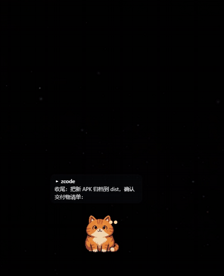
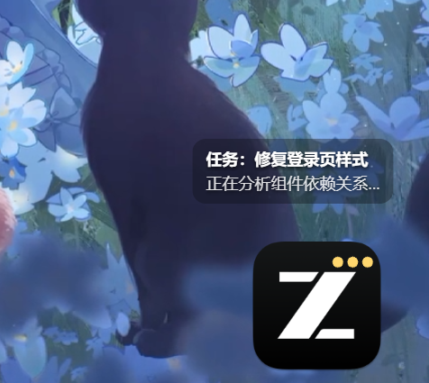
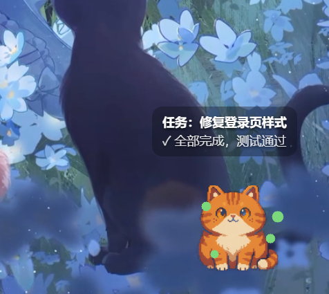
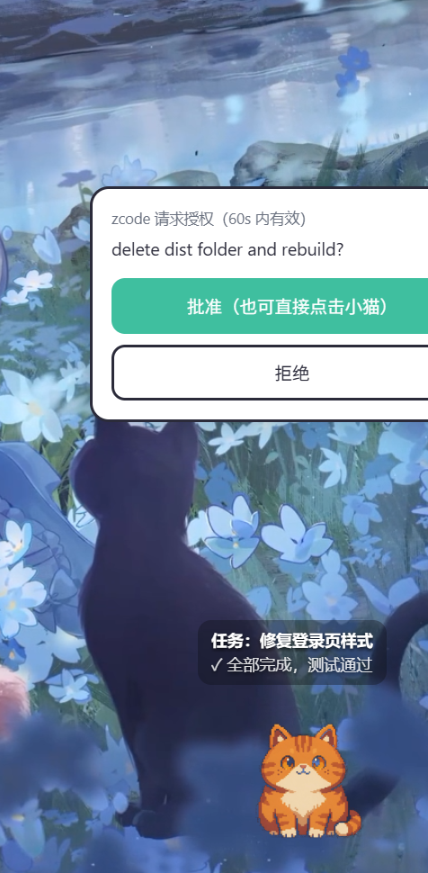

# Nekode 🐾

[](../../releases/latest)
[](../../releases/latest)
[](LICENSE)

[English](README.md) | [简体中文](README.zh-CN.md)

**A desktop pet that watches your AI coding agents work.**

<p align="center">
  
</p>

Nekode is a desktop pet that lives in a corner of your screen. It taps into the
hook mechanisms of AI coding agents and turns their lifecycle events — task
started, tool activity, waiting for your approval, done, error — into sprite
animations and speech bubbles, so you always know what your agents are up to
without staring at a terminal.

Works with Claude Code, Codex, Hermes, Cursor, ZCode, CodeBuddy and DeepSeek
Harness. Set up once, and every agent is under one cat's watch.

> Nekode = **Neko** (cat) + **Code**: the cat that watches your code.

## Features

- 🐱 **Status animations + speech bubbles** — idle / working / waiting / celebrating / error, switched automatically
- 🔌 **Multi-agent** — a unified event bridge built on each agent's hook mechanism; adding a new agent is just one config template
- 🎨 **Skin system** — switch skins from the tray menu; pixel art, app icons, any sprite sheet works as a skin
- 🖱️ **Two-way interaction** — click the cat to approve a permission request; choice cards (`pet_ask`) let the agent ask you a question
- 🪄 **Auto skin per agent** — while a single agent is active, the cat wears that agent's skin
- 🫧 **Zero-distraction** — bubbles are permanently click-through; never blocks your desktop or steals focus
- ⚙️ **Settings panel** — skin picker, bubble duration, auto-start, position reset
- 🪶 **Lightweight** — built with Tauri 2, ~1.6 MB installer, tens of MB in memory

## Screenshots

<p align="center">
  
  
  
</p>

## Supported agents

| Agent | Integration | Effort |
|---|---|---|
| Claude Code / ZCode / CodeBuddy | native hooks | ⭐ one line |
| Codex CLI / desktop | `notify` config (with a forwarder, keeps original notifications) | ⭐⭐ |
| Hermes Agent | `config.yaml` hook block | ⭐ |
| Cursor & hook-less agents | MCP tool (soft integration) | ⭐⭐ |
| DeepSeek Harness | session-log watcher, zero config | ⭐ automatic |

Full per-agent setup: **[integrations/README.md](integrations/README.md)**.

## How it works

```
AI agents (one line of hook config each)
   ↓  hooks / notify / MCP
Event bridge (local 127.0.0.1 HTTP service, unified event format)
   ↓  start / progress / waiting / done / error
Pet (transparent always-on-top window: animations + bubbles)
```

## Quick start

Download the latest installer from [Releases](../../releases/latest):

- **Windows**: `Nekode_x.y.z_x64-setup.exe`
- **macOS**: `Nekode_x.y.z_universal.dmg` (built by GitHub Actions)

Then wire up your agents — all config snippets are in
[integrations/README.md](integrations/README.md).

Verify the event bridge while the pet is running:

```bash
curl "http://127.0.0.1:21435/e?agent=test&event=done&msg=hello"
```

### Build from source

```bash
npm install
npm run tauri build
# Output: src-tauri/target/release/bundle/nsis/*.exe
```

Requires Node 20+, Rust 1.77+, and the platform WebView runtime (WebView2 ships with Windows).

## Skin system

A skin lives in `skins/<name>/`: a `manifest.json` (name + frame size) plus five
state sprite sheets (idle / working / waiting / success / error, frames laid out
horizontally; frame count = image width ÷ frame width).

- Built-in skin: the original Nekode pixel cat
- Turn any PNG icon into a skin: `node scripts/gen-skins.mjs` (source images in `design/logos/`)
- ⚠️ AI agent logos are their owners' trademarks — local personal use only, do not redistribute

## License

[MIT](LICENSE) © Nekode contributors
